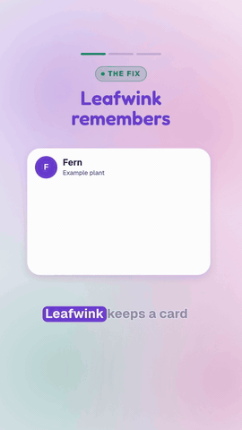
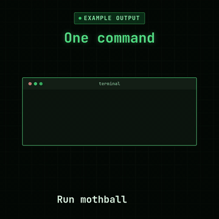
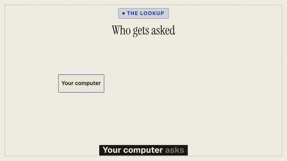
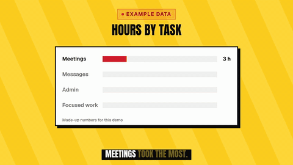

# reel-studio

[](https://github.com/VinVirtual/reel-studio/actions/workflows/test.yml) [](LICENSE)

Short voiced motion-graphics videos made from a text script, entirely on your own machine.

You write two small JSON files: a **script** (a list of scenes, each with a line to say and what to show) and a **brand** (colours, fonts, voice). reel-studio speaks the lines with a local text-to-speech model, draws every frame in a headless browser, and encodes an MP4 with word-by-word captions, music and sound effects. Nothing is uploaded and no paid service is used.

## Examples

Made by the scripts in [`examples/`](examples/). Click a preview for the video with sound.

| Product promo | Developer tool | Explainer | Data story |
|:---:|:---:|:---:|:---:|
| <a href="examples/promo/promo.mp4"></a> | <a href="examples/devtool/devtool.mp4"></a> | <a href="examples/explainer/explainer.mp4"></a> | <a href="examples/datastory/datastory.mp4"></a> |
| vertical · `pastel` | square · `terminal` | landscape · `paper` | embed · `poster` |
| [video](examples/promo/promo.mp4) · [script](examples/promo/script.json) · [brand](examples/promo/brand.json) | [video](examples/devtool/devtool.mp4) · [script](examples/devtool/script.json) · [brand](examples/devtool/brand.json) | [video](examples/explainer/explainer.mp4) · [script](examples/explainer/script.json) · [brand](examples/explainer/brand.json) | [video](examples/datastory/datastory.mp4) · [script](examples/datastory/script.json) · [brand](examples/datastory/brand.json) |

The apps, tools and numbers in these are invented, and say so on screen. [`examples/README.md`](examples/README.md) shows how to render each one again.

It is packaged as a [Claude Code](https://claude.com/claude-code) skill (`SKILL.md` tells the assistant how to use it), and it also works by hand from the command line.

## What it makes

- Vertical (1080×1920), square (1080×1080) and landscape (1920×1080) video at 30 fps, plus an `embed` format with larger type for video shown small inside a web page.
- Scene types: title, bullets, chat thread, card, big number, two-column compare, quote, image, call to action, numbered steps, box-and-arrow diagram, bar chart, code or terminal panel, timeline, and your own custom scenes in JavaScript.
- Six ready-made themes (`reel themes`) that differ in colours, fonts, background, corners, shadows, motion and caption style. A `style` block in `brand.json` sets the same things by hand.
- Elements appear on the word that names them (`"at": "word"`).
- Captions burned in (optional) and as `.vtt` and `.srt` files.
- A web copy: a small 720p faststart MP4 and a poster JPEG.
- A batch build for many scripts that share one brand.

## Limits

- It makes **motion graphics from a script**. It is **not a generative video model**: it does not create footage, people, photos or illustrations. Pictures come from files you supply (screenshots, photos).
- The voice is Kokoro. It covers American and British English, Spanish, French, Hindi, Italian, Japanese, Brazilian Portuguese and Mandarin Chinese, with a fixed set of voices. It does not clone voices.
- Word timings come from the voice model's own phoneme durations, read through kokoro-onnx 0.6 or newer. `scripts/measure_word_timing.py` checks them against the audio. It uses 8 list-like sentences ("Red, green, blue, …") said by 4 voices at 2 speeds, which gives 73 words that come after a pause, the only places where a word's start can be read from the sound. There, word starts were 17 ms from the sound onset on average, 90% within 36 ms, and at most 50 ms off. The old syllable estimate was 166 ms off on average and up to 465 ms. The script prints these figures when you run it. Inside a phrase with no pauses there is nothing to measure against, so the figure is not proven there.
- Reading those durations makes the voice step use more memory while the model loads: with nothing cached, `reel audio` peaked at about 1.0 GB, against about 0.56 GB with the estimate (measured on one 33-second script). With an older kokoro-onnx, another model file or `REEL_TIMING=estimate`, times are estimated from syllable counts instead, as before, and `reel audio` says which was used.
- The music is a simple generated beat. For anything else, use the `-voiceonly.mp4` and add music in your editor.
- Layout is automatic and has limits. `reel lint` and the review sheet show what does not fit; long text has to be shortened.
- Tested on Linux with Chrome. macOS is supported by the scripts but has not been tested by the author. Windows is untested.

## Requirements

| Needed | Why | Licence |
|---|---|---|
| Node.js 18 or newer | runs the renderer | MIT |
| [playwright-core](https://www.npmjs.com/package/playwright-core) | drives the browser | Apache-2.0 |
| Google Chrome, Chromium or Playwright's own Chromium | draws the frames | Chrome: proprietary freeware. Chromium: BSD-style and others |
| Python 3.10 to 3.13 | runs the voice step | PSF |
| [kokoro-onnx](https://github.com/thewh1teagle/kokoro-onnx) (0.6 or newer for measured word timings) | text to speech | MIT |
| Kokoro v1.0 model files (`kokoro-v1.0.onnx`, `voices-v1.0.bin`, about 340 MB) | the voice model | Apache-2.0 (see the note below) |
| phonemizer and espeak-ng (installed with kokoro-onnx) | turn text into phonemes | GPL-3.0-or-later |
| onnxruntime, numpy, soundfile (installed with kokoro-onnx or beside it) | run the model, write audio | MIT, BSD-3-Clause, BSD-3-Clause |
| ffmpeg with libx264 and AAC | encodes the video | LGPL or GPL, depending on the build. The binary from `imageio-ffmpeg` is a GPL build |

None of these is included in this repository. You install them yourself, and their licences apply to your use of them.

About 1 GB of disk space and 4 GB of free memory are enough. No GPU is needed.

### Licence notes

Checked on 21 November 2026. Check again before you rely on them.

- **Bundled fonts** (`assets/fonts/`): Fraunces (Copyright 2020 The Fraunces Project Authors), Geist (Copyright 2024 The Geist Project Authors), JetBrains Mono (Copyright 2020 The JetBrains Mono Project Authors), Anton (Copyright 2020 The Anton Project Authors), Instrument Serif (Copyright 2022 The Instrument Serif Project Authors) and Fredoka (Copyright 2016 The Fredoka Project Authors) are all under the **SIL Open Font License 1.1**, as stated in the licence field inside each font file. The last four were taken unchanged from the Google Fonts repository (`ofl/jetbrainsmono`, `ofl/anton`, `ofl/instrumentserif`, `ofl/fredoka`), where each has an `OFL.txt` saying the same. None of the six declares a Reserved Font Name. The OFL allows bundling and redistribution, including in commercial work, provided the copyright and licence notice travel with the fonts and the fonts are not sold on their own. `assets/fonts/OFL.txt` carries the notices.
- **kokoro-onnx** is MIT (its `LICENSE` file). Its README says the Kokoro model is Apache-2.0.
- **Kokoro-82M** (the model, by hexgrad) is tagged Apache-2.0 on its Hugging Face model card. The model card does not give a separate licence for the individual voice files, and neither does the kokoro-onnx release page for `voices-v1.0.bin`. This could not be verified beyond the model's own Apache-2.0 tag.
- **phonemizer** (GPL-3.0-or-later, from its package metadata) and **espeak-ng** (GPL-3.0-or-later, from its README) are loaded by kokoro-onnx inside the Python process that runs `engine/gen_audio.py`. If you redistribute a bundle that includes them, or build a product on top, read the GPL's terms. This is not legal advice.
- **ffmpeg** is run as a separate program. Its licence depends on how your copy was built.
- **Videos you make** are yours. Check the licence of any fonts, images and logos you add to a project.

reel-studio's own code is under the **MIT License** (see `LICENSE`). The bundled fonts keep their own licence, as above.

## Install

```bash
# 1. the skill itself (for Claude Code; any folder works if you only use the command line)
git clone https://github.com/VinVirtual/reel-studio ~/.claude/skills/reel-studio

# 2. voice: a Python venv with Kokoro, and the two model files
python3 -m venv ~/kokoro/.venv
~/kokoro/.venv/bin/pip install kokoro-onnx soundfile numpy imageio-ffmpeg
curl -L -o ~/kokoro/kokoro-v1.0.onnx https://github.com/thewh1teagle/kokoro-onnx/releases/download/model-files-v1.1/kokoro-v1.0.onnx
curl -L -o ~/kokoro/voices-v1.0.bin  https://github.com/thewh1teagle/kokoro-onnx/releases/download/model-files-v1.1/voices-v1.0.bin

# 3. renderer: Playwright, and a browser if you have no Chrome
npm i -g playwright-core
npx playwright-core install chromium     # optional when Google Chrome is installed; a good fallback either way

# 4. check
~/.claude/skills/reel-studio/reel check
```

`imageio-ffmpeg` brings its own ffmpeg binary. Leave it out if you already have ffmpeg on your PATH.

Everything is found in default places that you can change with environment variables:

| Variable | Default | What |
|---|---|---|
| `KOKORO_HOME` | `~/kokoro` | folder with the model files and the `.venv` |
| `KOKORO_MODEL`, `KOKORO_VOICES` | `$KOKORO_HOME/kokoro-v1.0.onnx`, `$KOKORO_HOME/voices-v1.0.bin` | the two model files |
| `REEL_PYTHON` | `$KOKORO_HOME/.venv/bin/python`, else `python3` | Python that has kokoro-onnx |
| `FF` | `ffmpeg` on PATH, else the one from imageio-ffmpeg | ffmpeg binary |
| `PLAYWRIGHT_CORE` | found through node from the skill folder, then `npm root -g`; never the current folder | folder of playwright-core |
| `REEL_CHROME` | installed Chrome, then other browsers found, then Playwright's Chromium | browser binary to try first |

## Quick start

```bash
R=~/.claude/skills/reel-studio
$R/reel new my-video            # brand.json, script.json (an example that shows the scene types), custom.js, fonts/. Add --theme <name> for another look
$R/reel lint my-video           # check the script and the layout
$R/reel audio my-video          # voice, timings, captions files
$R/reel sheet my-video          # stills/script-sheet.png: one frame per scene. Look at it.
$R/reel video my-video --web    # out/script.mp4, plus out/web/script.mp4 and a poster
```

Edit `my-video/script.json` and `my-video/brand.json`, then run the steps again. `references/scenes.md` lists every scene type and field, and `SKILL.md` has the writing rules.

### A finished example

`examples/` holds five finished scripts, four of them with the rendered video beside them (see the top of this page). Each folder is a project, so it renders where it is:

```bash
$R/reel audio $R/examples/demo && $R/reel video $R/examples/demo --web
```

### Themes

```bash
$R/reel themes                              # list them
$R/reel new my-video --theme paper          # start from one
$R/reel new my-video --theme poster --format square
```

| Theme | Look |
|---|---|
| `ember` | warm dark, serif italic headline, glowing dots. The look you get without `--theme` |
| `midnight` | deep navy with drifting colour, tight sans headline, a block that follows the spoken word, scenes slide sideways |
| `paper` | cream paper with grain and a thin rule, ink text, serif headline, no shadows, boxed captions, slow fades |
| `poster` | yellow and black, condensed capitals, square corners, hard shadows, striped background, quick moves |
| `pastel` | soft lilac with drifting colour, rounded headline, very round corners, bouncy pop-ins |
| `terminal` | green on black, monospaced type, ruled grid, hard cuts |

A theme is an ordinary `brand.json` (they are in `themes/`). The parts that set the look are `colors`, `fonts`, `background` and `style`; `SKILL.md` lists every `style` key. `reel lint` warns when a brand's text colours have too little contrast to read, and the tests check that for every bundled theme.

## Commands

| Command | What it does |
|---|---|
| `reel check` | checks Python, Kokoro, ffmpeg, node, Playwright and that a browser really starts |
| `reel themes` | lists the ready-made looks |
| `reel new <dir>` | starts a project from the templates. `--theme <name>` uses a theme as `brand.json`, `--format <f>` sets the shape |
| `reel lint <project> [script]` | reports words in `at`/`keys` that are never spoken, text over the length guide, missing files, unknown types and fields, and content that overflows or overlaps (measured in the real engine). `--no-browser` skips the layout part, `--strict` fails on warnings, `--json` prints JSON |
| `reel audio <project> [script]` | voice, word timings, music and SFX mix, `.vtt` and `.srt` |
| `reel sheet <project> [script]` | one frame per scene in a single PNG |
| `reel stills <project> [script] 1.5 4` | frames at those seconds |
| `reel video <project> [script]` | `out/<script>.mp4`, `-voiceonly.mp4`, `.vtt`, `.srt`. `--web` adds the web copy |
| `reel web <project> [script]` | `out/web/<script>.mp4` (720p, CRF 27, mono 64k AAC, faststart), `<script>.jpg` poster without captions, `<script>.vtt` |
| `reel captions <project> [script]` | only the `.vtt` and `.srt` |
| `reel preview <project> [script]` | serves a page on this machine (`http://127.0.0.1:4173/`, or `--port N`) that plays the video with its voice and a scrub bar, drawn live by the engine. Visual edits to the script or brand show within a second or two; a changed spoken line needs `reel audio` |
| `reel build <project> [scripts...]` | voice + video for many scripts. `--jobs N` at a time, `--web`, `--force`. Skips unchanged scripts, continues after a failure, exits non-zero with a summary |
| `reel test` | runs the unit tests (plain `node --test`, no extra packages) |

`script` defaults to `script`.

`--format vertical|square|landscape|embed` on `lint`, `sheet`, `stills`, `video`, `web`, `build` and `preview` uses that shape for one run instead of the `format` in `brand.json`. The files are named `<script>-<format>` (`out/script-square.mp4`, `stills/script-square-sheet.png`, `out/web/script-square.mp4`), so shapes do not overwrite each other, and they share one voice track. Lint with `--format` checks the layout of that shape. A hand-set `layout` in `brand.json` belongs to the brand's own shape and is left out when the shape changes. The command stops with an error if the project already has a script with the output name, for example `promo-square.json` when you run `promo --format square`, because the two would overwrite each other's files. Rename one of them.

Other options: `--no-captions`, `--workers N`, `--lossless`, `--quality 0.95`, `--web-size 720`, `--web-crf 27`, `--web-dir <dir>`, `--poster-at <seconds>`.

## How it works

1. `engine/gen_audio.py` speaks each phrase with Kokoro, reads when each word starts from the model's phoneme durations (`engine/word_timing.py`), and writes a timeline (`build/<script>.timeline.json`) and two audio mixes.
2. `engine/engine.js` and the scene files draw a frame for any time `t` on a canvas. A frame depends only on `t`, so frames can be drawn in any order, in several browser pages at once, and every render of the same inputs gives the same video.
3. `engine/lib/video.mjs` collects the frames and pipes them to ffmpeg.

## Development

```bash
./reel test                      # unit tests for layout maths, lint rules, themes and contrast, code scenes, captions, build planning, word alignment
./reel lint  <project>           # layout checks run in the real engine
./reel sheet <project>           # then look at the PNG
```

Scene types live in `engine/scenes.js`, `engine/scenes-explain.js` and `engine/scenes-dev.js`. Layout maths that can be tested without a browser lives in `engine/fit.js`.
